# Project Aintinai (ஐந்திணை) — Official Design System & Token Ground Truth

This document specifies the design tokens, color architecture, typography scales, and motion specifications for the OSU Tamil Sangam digital platform (`tamil-sangam-website-osu`).

It adheres to the **W3C Design Tokens Community Group (DTCG)** three-tier hierarchy and **perceptually uniform OKLCH color spaces** grounded in the **official OSU Tamil Sangam emblem** and the **Master Kanchipuram Courtyard & Temple Stone Token System**.

---

## 1. Three-Tier Token Architecture

```mermaid
flowchart LR
    subgraph Primitive["Tier 1: Primitive Tokens"]
        P1["oklch(0.38 0.22 305) - Sangam Deep (#1C122B)"]
        P2["oklch(0.78 0.16 168) - Electric Mint Teal (#A6F0CF)"]
        P3["oklch(0.97 0.015 85) - Warm Ivory (#FAF6F0)"]
        P4["oklch(0.92 0.035 80) - Sunbaked Sandstone (#F0E6D6)"]
        P5["oklch(0.72 0.14 78) - Zari Gold (#C79347)"]
        P6["oklch(0.55 0.12 185) - Brand Teal (#0F766E / #2BB5A8)"]
    end
    subgraph Semantic["Tier 2: Semantic Tokens"]
        S1["--color-bg-ivory / --color-bg-sangam-deep"]
        S2["--color-surface-card-light / --color-surface-card-dark"]
        S3["--color-ink-earth / --color-ink-alabaster"]
        S4["--color-accent-zari / --color-brand-teal"]
    end
    subgraph Component["Tier 3: Component Tokens"]
        C1["--button-primary-bg"]
        C2["--envelope-clasp-border"]
        C3["--kolam-node-stroke"]
        C4["--navbar-pill-background"]
    end
    Primitive --> Semantic --> Component
```



---

## 2. Color Architecture: Kanchipuram Courtyard & Temple Stone

The palette balances warm, editorial daytime courtyard readability with royal nocturnal temple anchors. Strictly zero pure black (`#000000`) and zero dead un-tinted grays.

### Pillar 1: Sunlit Temple Neutrals (Courtyard & Editorial Grounds)

| Token Name | Cultural Name | Hex / CSS Value | Role & Character |
| :--- | :--- | :--- | :--- |
| `--color-bg-ivory` | வெண்முத்து (Warm Ivory) | `#FAF6F0` | Primary courtyard background, warm editorial canvas |
| `--color-bg-sandstone` | மணற்பாறை (Sandstone) | `#F0E6D6` | Secondary courtyard ground, pill highlights, card backings |
| `--color-surface-card-light` | வெள்ளைத்தாள் (Pure White Card) | `#FFFFFF` | Daytime editorial cards, guide listings, paper panels |
| `--color-surface-card-parchment`| ஏட்டுச்சுவடி (Parchment Card) | `#F7EFE2` | Elevated parchment surfaces, dossier cards |
| `--color-border-warm` | மணற்கோடு (Warm Sand Border) | `#DFD1BE` | Subtle daytime card borders and dividers |

### Pillar 2: Royal Deep Anchors (Temple Nocturne & Cinematic Surfaces)

| Token Name | Cultural Name | Hex / CSS Value | Role & Character |
| :--- | :--- | :--- | :--- |
| `--color-bg-sangam-deep` | அரச கருநீலம் (Sangam Deep) | `#1C122B` | Primary nocturne ground, hero backgrounds, navbar pill |
| `--color-surface-card-dark` | அந்தி மாடம் (Dark Card Surface) | `#271A3C` | Elevated dark cards, linktree cards, drawer containers |
| `--color-bg-peacock-deep` | மயில் கருநீலம் (Peacock Deep) | `#102830` | Oceanic temple base, games hub arcade ground |
| `--color-surface-card-peacock` | மயில் மாடம் (Peacock Card) | `#173640` | Arcade cards, interactive game grids |

### Pillar 3: Hero Bridging & Metallic Accents

| Token Name | Cultural Name | Hex / CSS Value | Role & Character |
| :--- | :--- | :--- | :--- |
| `--color-accent-zari` | சரிகைத்தங்கம் (Zari Gold) | `#C79347` | Metallic filigree, kolam nodes, premium borders |
| `--color-accent-bronze` | சிற்ப வெண்கலம் (Temple Bronze) | `#9A6B3E` / `#D4A36A` | Architectural borders, warm metallic clasps |
| `--color-brand-teal` | மரகதப்பச்சை (Emerald Teal) | `#0F766E` / `#2BB5A8` | Interactive accents, live tags (`NEXT`), hover blooms |
| `--color-accent-kumkum` | குங்குமம் (Kumkum Red) | `#B84A39` / `#E06D58` | Urgency tags, badge pings, festive highlights |
| `--color-brand-lavender` | நீலாம்பரி (Soft Lavender) | `oklch(80.2% 0.075 304.4)` | High-contrast accent on peacock/sangam-deep (8.1:1 contrast) |
| `--color-border-zari-muted` | சரிகைக்கோடு (Muted Zari Border)| `rgba(212, 163, 106, 0.24)` | Subtle gold borders on dark containers |

### Pillar 4: Ink & Typographic Hierarchy

| Token Name | Cultural Name | Hex / CSS Value | Role & Character |
| :--- | :--- | :--- | :--- |
| `--color-ink-earth` | சுடுமண் மை (Earth Ink) | `#261A14` | High-contrast daytime body and headline typography |
| `--color-ink-umber` | கருங்காப்பி மை (Umber Ink) | `#5E4C40` | Secondary daytime typography, subheadings, metadata |
| `--color-ink-alabaster` | பளிங்கு மை (Alabaster Ink) | `#FAF5ED` | High-contrast nocturne headline and primary text |
| `--color-ink-sand` | மணல் மை (Sand Ink) | `#CBBBA8` | Secondary nocturne typography, telemetry labels |

---

## 3. Official Emblem Palette (Emblem Engine & Chromatic Accents)

The official OSU Tamil Sangam emblem anchors these chromatic accents:

| Token Name | Cultural Name | Value | Role |
| :--- | :--- | :--- | :--- |
| `--color-sangam-purple` | அரச ஊதா (Royal Purple) | `#6B4E94` / `#4c2472` | Emblem core body, regalia banners |
| `--color-sangam-mint` | மரகதம் (Electric Mint) | `#A6F0CF` / `#55CCA2` | Emblem 3D extrusion, luminous interactive accents |
| `--color-sangam-lilac` | நீலாம்பரி (Watermark Lilac) | `#C4B7D7` / `#e9d5ff` | Watermarks, subtle icons, decorative glyphs |
| `--color-sangam-cream` | வெண்முத்து (Cream Ivory) | `#F4F0FA` / `#fffdf9` | Emblem text fill, crisp light foreground |
| `--color-sangam-coral` | குங்குமச் சிவப்பு (Chromatic Pink) | `#F26BB5` | Chromatic fringe, celebration banners |
| `--color-sangam-cyan` | மயிற்பச்சை (Chromatic Cyan) | `#4FD6E0` | Cybernetic accents, WebGL lens flare highlights |

---

## 4. Typography Hierarchy & Bilingual Standards

The typography balances classic Dravidian monumental grace with crisp collegiate readability.

```text
Display / Serif:  Marcellus, Prata, Cormorant (fallback: serif)
Body / Sans:      Outfit (fallback: system sans-serif)
Authentic Tamil:  Mukta Malar (fallbacks: Tiro Tamil, Kavivanar, serif)
Mono / Data:      Fragment Mono, Azeret Mono, JetBrains Mono
```

### Tamil Script Invariants (§7.3)
- **Attribute**: All Tamil script must be wrapped in `lang="ta"`.
- **Zero Letter-Spacing**: Never apply tracking or letter spacing to Tamil script (`letterSpacing: 0` / `tracking-normal`). Expanding Tamil breaks conjunct ligatures.
- **Line Height**: Minimum `leading-[1.6]` to `leading-[1.72]` to prevent vowel sign (`கொம்பு`, `சுழி`) vertical clipping.
- **Grapheme Splitting**: Never split Tamil strings by UTF-16 code units (`str.split('')`). Always use `Intl.Segmenter` with `{ granularity: 'grapheme' }` via `src/lib/tamil.ts` or `src/lib/tamilGraphemes.ts`.
- **No Uppercase**: Never apply CSS `uppercase` or `capitalize` transforms to Tamil text.

### Fluid Typography Scale (§7.1)
- `--text-display`: `clamp(2.5rem, 1rem + 5vw, 6rem)` — Hero H1 titles.
- `--text-title`: `clamp(1.75rem, 1rem + 2.6vw, 3.5rem)` — Section headings.
- `--text-body`: `clamp(1rem, 0.95rem + 0.25vw, 1.125rem)` — Editorial body copy.
- `--text-mark`: `clamp(8rem, 5rem + 22vw, 26rem)` — Decorative watermarks (`aria-hidden="true"`).

---

## 5. Modern Motion Engineering & Physics Parameters

All animations must honor user accessibility preferences via `prefers-reduced-motion` and the project Lite Mode toggle.

| Interaction Type | Engine | Specification / Curve | Usage |
| :--- | :--- | :--- | :--- |
| **Direct Manipulation** | Spring | `stiffness: 260–350, damping: 24–28` | Kolam knot unrolling, button hover magnetism, tilt cards |
| **Systemic Transitions** | Tween | `duration: 0.35s, ease: [0.16, 1, 0.3, 1]` | Route changes, modal backdrops, drawer expansions |
| **Kolam Progress Weaving** | SVG Path | `pathLength: 0 → 1, ease: "easeInOut"` | Page loader Brahmamudi knot unspooling & telemetry count |
| **Choreographed Stagger** | Variants | `staggerChildren: 0.05s–0.08s, delayChildren: 0.05s` | Navigation links unrolling, card grids, photo vault tiles |
| **Shared Element Morph** | Framer | `layoutId`, `layout` | Envelope to photo album expansion, game victory modals |

---

## 6. Signature Cultural Components

1. **Sikku Kolam Dual-Trigger Navbar (`src/components/navigation/Navbar.tsx`)**:
   - Collapsed state: Elegant floating glass pill (`--bg-sangam-deep`) displaying active route context alongside a 4-petal Brahmamudi knot toggle.
   - Dual-trigger activation: Clicking either the context pill or the knot toggle opens the menu.
   - Expanded state: Spring-unraveled menu revealing 8 prioritized primary routes with gold borders (`--border-zari-muted`) and mobile 2-column responsive layout.

2. **Progress-Driven Kolam Loader (`src/components/ui/KolamLoader.tsx`)**:
   - Replaces abrupt flash spinners with continuous geometric rice-flour thread weaving.
   - Displays real-time telemetry (stage, coordinates, percentage counter) and cultural aphorism.

3. **Photo Vault Studio Envelopes (`src/components/gallery/`)**:
   - Tactile Kanchipuram silk and parchment paper envelopes with string-and-washer clasps.
   - Hover reveals randomized authentic Polaroid scatter previews before opening full photo vaults.

4. **Sangam Arcade Daily Suite (`src/components/games/`)**:
   - Unified 12-game arcade hub (`/games`) framed in deep peacock stone (`--bg-peacock-deep`).
   - Daily puzzle rotations (Sollu Wordle, Thodarbu Connections, Kolam Path Solver, Thirukkural Memory).
