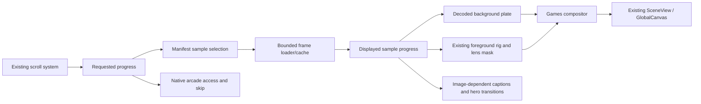

# Games hero: hybrid cinematic production PRD

Status: implementation in progress; engineering and asset evidence tracked separately from production acceptance.
Date: 2026-10-27. Route: `/games`. Approach: Option B, offline background rendering with live foreground hand and eyewear.

## Latest user revision: fixed camera and smoother playback

The subsequent implementation request supersedes the portal and synchronization details below. The original specification remains historical context; the following rules govern current acceptance:

- Keep the background camera, projection, FOV and framing stationary for the entire sequence. Remove the 28-metre exit travel, camera shake/sway, portal zoom and any equivalent baked zoom. Foreground must not zoom into a lens at the exit.
- Make the hand's entrance smooth, then hold the gripping pose without tremor. Retain a restrained final fade. Drive live hand movement from continuous requested progress so holding a nearest background sample does not freeze or step the hand.
- Keep background-dependent focus, lens treatment, blast light and beat captions tied to the displayed plate's progress. Continuous hand progress and quantized displayed-media progress are intentionally separate; this replaces the earlier requirement that every foreground transform use the sampled plate progress. The shared canonical content rectangle and lens projection contracts still apply.
- Follow the hero with ordinary document-flow arcade content. Remove the negative-margin/transformed editorial overlay and lens portal handoff. Normal scrolling must reach the games without stealing focus; explicit skip focuses the arcade immediately and scrolls to its actual document position.
- Deliver a visibly evolving, impactful explosion sequence with original rendered fire/smoke/dust, rather than repeating one blast still under different sample filenames. The current regeneration target is 149 genuine timeline samples; final count, unique hashes, calibration and bytes require post-encode verification. This is not a production-quality approval.
- Pause optional requests/draws while hidden, preserve bounded state across visibility changes, and pause the startup deadline before a hidden visit can falsely time out. Offscreen reentry must not reuse closed bitmaps or disposed foreground resources.

Current source/media checks and unresolved art, browser and performance limits are recorded in [implementation evidence](games-hero-hybrid-cinematic-evidence.md). Old portal endpoint assertions and earlier passing v1.1 milestones are historical evidence, not acceptance of this revised behavior. No deployment is authorized.

## 1. Product decision

Replace the procedural beach and real-time explosions with an original Blender-rendered sequence. Keep the hand and glasses in Three.js, preserve calibrated lens registration, and retain the existing scroll-to-arcade experience.

The first release uses numbered WebP images, a small frame cache, one posed anatomical hand GLB, and the existing foreground renderer. Background focus, atmospheric depth, fire, smoke, debris, shadows, and blast illumination are baked together. This concentrates production work in one Blender scene and removes most background simulation from the browser.

“Free” means zero required spending on software licenses, assets, render farms, APIs, or new services. Use existing hardware and hosting. Electricity, disk space, production time, and any existing hosting charges remain costs. Free hosting capacity is finite; no traffic or deployment quota has been verified for this project.

“Easy” means a small, repeatable production pipeline with explicit quality gates. Anatomical skin, believable explosions, and reference matching still require art work. No promise of automatic film-quality output or completion in a weekend.

### Goals

- Make paused frames convincing at establishing, close-up, explosion, and exit beats.
- Preserve the glasses as the compositional anchor and the arcade as the primary destination.
- Make forward and reverse scrolling select the same visual state.
- Keep the first usable page lightweight, with immediate skip access and a useful static fallback.
- Give a developer and a Blender artist enough detail to implement without redesigning the architecture.

### Outside this release

- Free-camera exploration, interactive destruction, browser fluid simulation, live background depth reconstruction, and dynamic weather.
- Paid assets, paid plugins, Houdini, cloud rendering, AI generation credits, or runtime third-party media APIs.
- New sound or soundtrack production, an arcade redesign, or changes to puzzle logic, storage, editions, and Tamil content.
- Animated portrait backgrounds, KTX2/Draco/Meshopt tooling, WebCodecs, workers, or a video player unless measured limitations justify a later change.

## 2. Current implementation and boundaries

These observations concern the local working tree, not a verified production deployment. The three referenced film screenshots were not supplied as inspectable attachments in this task. Pixel comparisons against them remain an implementation input.

| Existing owner | Verified responsibility | Planned change |
| --- | --- | --- |
| [Games route](../../src/app/games/page.tsx) | Dynamic hero, initial poster, `#arcade`, editorial handoff, GamesHub | Preserve page structure; use approved original poster |
| [GamesHeroCanvas](../../src/components/games-hero/GamesHeroCanvas.tsx) | Scroll progress, four captions, debug progress, skip, stills, Lite/tier fallback, offscreen mounting | Add media readiness and fallback integration; keep navigation behavior |
| [GamesFocusScene](../../src/components/games-hero/GamesFocusScene.tsx) | Separate background/foreground scenes, lens mask, render targets and blur | Feed decoded background plates into the compositor; retain foreground and mask |
| [gamesRail](../../src/components/games-hero/gamesRail.ts) | Camera/hand transforms, focus values, three impact times | Keep calibration; export sampled camera states and align timing with media |
| [Projection math](../../src/components/games-hero/camera/projectionMath.ts) | Aspect policy, FOV, lens shift, world/screen conversion | Preserve numeric contracts; use as Blender calibration source |
| [EyeglassHandRig](../../src/components/games-hero/EyeglassHandRig.tsx) | Foreground hand, eyewear, registered lens geometry | Replace hand surface with posed anatomical GLB; retain transforms and optical anchors |
| [BeachCompoundScene](../../src/components/games-hero/BeachCompoundScene.tsx) | Procedural environment | Leave out of the shipped hybrid render path after parity passes |
| [MissilePyroSystem](../../src/components/games-hero/MissilePyroSystem.tsx) | Procedural missiles and explosions | Bake corresponding background action offline; leave out of hybrid render path |
| [LayeredFocusCompositor](../../src/components/games-hero/compositor/LayeredFocusCompositor.ts) | Background depth blur, foreground blur, lens enhancement, tone mapping | Bypass background depth blur for baked plates; implement explicit plate color contract |

At inspection, the hand, pyro system, and compositor have uncommitted edits. Implementation must re-inspect and preserve that work. Do not restore those files from HEAD or treat older line numbers in the supplied critique as current source.

The existing rail is locked for the early sequence but travels 28 metres during the final portal move. The projection system uses a 2.39 design aspect, 34-degree desktop vertical FOV, and a separate portrait camera. A static flat background cannot reproduce the final move by applying a CSS zoom.

The root [PLAN.md](../../PLAN.md) and [PROGRESS.md](../../PROGRESS.md) describe the previous v1.1 work. Their completed milestones do not establish completion of this PRD.

## 3. Audience and experience

Primary visitors are students coming to play Sollu or Thodarpu. The hero should reward viewing without delaying access to either game.

1. The page shows an original establishing poster and a visible “Skip to Arcade” action immediately.
2. Eligible landscape devices load the foreground and nearby background frames progressively.
3. Scrolling moves through the cinematic beats. Pausing stops visual evolution; reversing restores prior states.
4. Dust and the existing editorial sheet introduce the arcade. The skip action always bypasses loading and animation.
5. Portrait, reduced-motion, Lite, and unsupported devices receive original stills and the same arcade access.

There is no blocking progress screen, forced viewing duration, autoplay sound, or extra click needed to unlock the games.

## 4. Creative and timing specification

Progress `p` is normalized from 0 to 1 using the current hero's scroll system. It is not wall-clock playback time. The four current caption beats remain; the missile approach is a sub-beat.

| Progress | Image and action | Focus and movement | Acceptance |
| --- | --- | --- | --- |
| 0.00–0.22 | Bright beach, broad negative sky/sand, detailed distant compound | Locked calibrated camera; stable lighting | Objects sit on sand; readable skyline; no repeating procedural patterns |
| 0.22–0.52 | Hand enters holding black glasses | Existing anchor path with soft acceleration/settling; background racks out of focus | Anatomy and grip read clearly at `p=0.42`; no clipping through temple |
| 0.52–0.64 | Three approaching missiles and restrained trails | Background returns toward focus; hand remains controlled | Anticipation is visible without obscuring the lenses |
| 0.64–0.85 | Staggered ignition, expansion, dust, debris, rising smoke | Sharp background action; existing foreground defocus | Three plumes remain legible together at `p=0.72`; frame does not become a uniform orange wash |
| 0.85–1.00 | Dust softens the scene and the editorial sheet takes over | Bake the existing exit camera rail; retain foreground fade | No plate/hand sliding during exit; arcade is usable at completion |

Baseline impact times stay at `0.640`, `0.646`, and `0.652` for the first parity pass. An art-review candidate may use `0.640`, `0.657`, and `0.674`; this is an intentional contract change, not a default replacement. Adopt it only after updating the media timeline and relevant assertions together, and confirming all three impacts remain readable at `0.72`.

Use a nominal eight-second Blender timeline as an authoring starting point: `t = 8p`. The viewer controls progress, so this is not an eight-second forced playback. Simulations can have preroll, which must be recorded separately from the visible time mapping.

Explosions need an irregular bright ignition, differently growing fire lobes, broad low dust, and persistent smoke. Begin with one baked gas simulation instanced at the three impact locations with varied timing, scale, and orientation. If repetition is obvious in the final shot, make a second bake. Keep debris and lighting in the offline scene so they occlude and illuminate the environment consistently.

Avoid clipped full-frame flashes, aggressive camera shake, heavy chromatic aberration, and flickering grain. Use restrained grain baked with a reproducible seed and inspect temporal stability after encoding.

## 5. Free production stack and asset policy

| Need | First choice | Constraint |
| --- | --- | --- |
| Scene assembly, posing, materials, compositing | Blender with built-in tools | Record the exact version; no required commercial add-ons |
| Final offline rendering | Cycles on an existing local CPU/GPU | Benchmark before selecting sample count and frame count |
| Sand, stucco, stone, daylight environment | Individual Poly Haven asset downloads | Save each asset page and license; self-host final outputs |
| Anatomical hand starting mesh | MakeHuman/MPFB core human mesh, refined and cropped in Blender | Core assets are a starting point, not a finished close-up hand |
| Hand skin maps | Included compatible core material or original author-created textures | Audit every map; do not assume community downloads share core licensing |
| SUV, palms, fountain | Suitable individually verified CC0 models; otherwise original Blender modeling | Asset availability and visual quality are not established by a library's license |
| Web delivery conversion | FFmpeg with WebP encoder | Check local encoder availability and inspect final output |
| Runtime | Installed React Three Fiber, Three.js, existing scroll/tier infrastructure | No new rendering engine, backend, or recurring service |
| Delivery | Existing same-origin static hosting | Stay within actual project limits; never enable paid capacity automatically |

Blender permits use of its rendered artwork without imposing its application GPL on that artwork. See [Blender licensing](https://www.blender.org/about/license/). Poly Haven publishes its HDRIs, textures, and models under CC0; that does not extend to all website content or remove separate API terms. Use manual asset downloads during production. See [Poly Haven licensing](https://polyhaven.com/license).

MakeHuman's core assets provide a free human-model starting point. Audit separately downloaded assets individually. See [MakeHuman licensing](https://www.makehumancommunity.org/about/license.html) and its [export usage FAQ](https://download.makehumancommunity.org/makehuman/faq/can_i_sell_models_created_with_makehuman.html).

For each external model, texture, or HDRI, record creator, source URL, download date, exact license, required attribution, modifications, and final output paths in [assets/RIGHTS.md](../../assets/RIGHTS.md). Include the original license text where provided. An unclear license blocks that asset from release.

Use original content inspired by the composition. Do not publish film frames, extracted footage, film audio, actor likenesses, or copied logos. Existing `j1`–`j4` poster provenance must be audited; replace unverified images with original Blender renders before the hybrid release.

## 6. Asset production requirements

### 6.1 Hand and glasses

Use one fixed gripping pose. The existing rig moves the posed hand/glasses assembly through the shot; runtime finger animation is unnecessary for this release.

- Extract the forearm and hand from the chosen anatomical mesh. Refine wrist taper, knuckles, nail beds, finger pads, and thumb opposition.
- Pose fingers around the existing glasses temple in Blender. Keep the glasses dimensions, lens centers, and registration surfaces unchanged.
- Hide the cropped arm boundary outside the camera frame. Test the entire entry/exit path, not only the close-up.
- Author a 2K base-color texture, tangent-space normal map, and spatially varying roughness. Use roughly 0.5 roughness as a starting point, with little or no clearcoat.
- Bake creases and small skin details; do not add high-density geometry for invisible detail. Any pale marks must be original textured details, not copied film imagery.
- Retain the current glasses silhouette; add restrained hinge and material detail only after registration passes. Avoid strong magnification or refraction that shifts the background landmarks.
- Export the final posed mesh as GLB with applied transforms, checked normal-map orientation, consistent units, and no external texture dependencies.

Proposed budgets: at most 80,000 visible triangles across hand and eyewear, 2K maximum skin maps, and 3 MiB transferred foreground assets. These are targets to validate, not measurements of an existing asset. If a smaller mesh visibly harms the silhouette, trade texture size or background bytes first and document the result.

The close-up is the first art gate. If the hand remains visibly primitive at `p=0.42`, stop final background rendering and fix it. A hand asset of acceptable quality has not yet been selected.

### 6.2 Environment

Preserve reference landmarks while replacing their visual surfaces. Place downloaded assets in the scene at the required scale; do not alter camera math to fit arbitrary model dimensions.

- Sand: scanned base color, roughness, normal detail, subtle displacement, compacted patches and tire contact impressions.
- Vehicles: credible wheel thickness, tire contact, glass, grille, lights, weathering, and restrained reflections. Remove brand marks from original production designs where needed.
- Palms: at least three distinguishable silhouettes, uneven fronds, and varied placement. Reuse meshes offline when repetition is not visible.
- Wall: plaster thickness, rough openings, exposed masonry, chipped edges and dirt.
- Fountain/garden: readable stone silhouette, contact shadows and material variation appropriate to its screen size.
- Lighting: one coherent sun direction plus a restrained daylight environment. Warm highlights and cooler shadows must remain consistent with the live foreground.

No environment GLBs or sand textures need to ship to the browser. Their complexity affects authoring and render time, not runtime draw calls.

### 6.3 Fire, smoke and dust

Use Blender's built-in gas simulation, cache the result to disk, and render from that cache. Baked simulations support reproducible frame evaluation; use a final bake rather than a preview dependent on interactive playback. See [Blender simulation baking](https://docs.blender.org/manual/en/latest/physics/baking.html).

Start with a low-resolution smoke/fire preview. Validate silhouette, timing, scale and lighting before raising resolution. Use emission for the hot core, dark smoke with sunlit edges, and a separate low dust layer if the gas bake does not produce a convincing ground disturbance.

Render fire illumination, vehicle/wall occlusion, debris, ground shadows, and smoke together. Add only a restrained matching warm light contribution to the live hand/glasses; its value must be derived from displayed progress. Background explosions do not require live point lights or browser debris systems.

## 7. Calibration and offline render contract

### 7.1 Camera export

Before art production, export camera position, orientation, projection matrix/FOV, lens shift, coordinate conversion, and timeline samples from the current TypeScript rail. Record the source commit and any working-tree differences used for export.

Import or reproduce those values in Blender. Three.js and Blender axis and camera conventions differ; do not copy Euler angles or lens-shift values blindly. Validate the conversion with projected landmark markers and screen-space comparisons at `1912×800` before assembling detailed assets.

The offline background must include the final portal camera travel. The foreground retains its separate camera and stable lens anchors. Preserve the existing rule that the foreground does not inherit the background impact impulse.

### 7.2 Aspect policy for the first release

A single 2.39 plate cannot exactly reproduce every existing wide-aspect projection. Use one canonical `1912×800` content rectangle for the animated hybrid release and contain it inside landscape viewports. Apply the same content rectangle to the plate, foreground camera, mask, and overlays. Letterboxing is an explicit presentation change for wide screens; it must not stretch the image or alter lens registration.

Compute the live foreground using the canonical content aspect. Do not use the outer window aspect for one layer and the contained rectangle for another. Keep projection helpers and their original multi-viewport tests intact; add browser checks for the new shared rectangle.

For outer viewport aspect below `1.3`, use an original portrait still set rendered from the existing portrait camera, with manual beat selection. Do not center-crop landscape plates: the portrait camera is laterally repositioned. This release intentionally extends static presentation to capable portrait devices to avoid a second animated production pipeline.

On rotation, cancel obsolete loads, clear incompatible frame state, and select the correct mode. The arcade layout must remain responsive independently of the hero content rectangle.

### 7.3 Sampling and export

Render a small contact sheet first at `p=0.10`, `0.42`, `0.72`, and `0.93`. Approve geometry, light and framing before rendering a sequence.

Start with approximately 120 unique background frames at `1912×800`. Use fewer samples during the held establishing shot and more during ignition, plume growth and exit travel. Set a first-release ceiling of 180 unique frames; beyond that, reevaluate transfer cost and smoothness before rendering more.

Include exact samples for the four debug checkpoints and every adopted impact onset. Each manifest entry contains an explicit progress value. Uniform `round(p * frameCount)` selection is inappropriate for nonuniform samples.

Render numbered PNG intermediates or an equivalent lossless authoring format, then encode individual opaque WebP files. This permits rerendering selected frames without restarting an entire video export. Keep lossless masters, simulations and `.blend` files out of `public/` and the website build.

Suggested output layout, all new paths proposed:

```text
art/games-hybrid/                    local production source; exclude large caches from Git
  games-hybrid.blend
  camera-samples.json
  renders/                          lossless intermediates
  cache/                            baked simulations
public/media/games-hybrid/v1/
  manifest.json
  landscape/frame-0000.webp
  landscape/...
  posters/establishing.webp
  posters/closeup.webp
  posters/blast.webp
  posters/exit.webp
  posters/portrait-*.webp
public/models/games/hand-grip.glb
```

Use an immutable version directory and deploy manifest plus all referenced files atomically. Keep production sources in an existing backed-up location or suitable repository storage; do not introduce paid large-file storage as a hidden dependency.

FFmpeg supports numbered image inputs and WebP encoding. See [image2 documentation](https://ffmpeg.org/ffmpeg-formats.html#image2-1) and [WebP encoder documentation](https://ffmpeg.org/ffmpeg-codecs.html#libwebp). Validate the installed encoder before committing to an export command. Quality around 80–85 is an initial experiment; accept output by visual inspection and bytes, not the numeric quality setting.

## 8. Runtime architecture and synchronization



### 8.1 One manifest and one frame owner

Keep frame scheduling in one small route-local controller. It owns requests, decoded frames, disposal and displayed progress. Avoid a generic media framework or new global store.

Required manifest data:

- Schema version, asset revision, width, height, color-space contract and content aspect.
- Ordered samples with unique numeric `p` values in `[0,1]`, relative image URL and encoded byte count.
- Poster URLs, total transferred bytes, and the source timeline/calibration identifier.
- A declared sampling interval covering both ends of the sequence and the four exact debug checkpoints.

Validate the manifest during asset preparation/build. Reject missing files, unsorted or duplicated progress keys, inconsistent dimensions, invalid paths, and exceeded budgets. Reuse existing Node assert conventions; no schema package is needed for this small static artifact.

### 8.2 Requested progress versus displayed progress

Select the nearest manifest sample to requested progress; ties choose the earlier sample. Both plate and live foreground must use that sample's progress once its image is ready. This guarantees coherent registration even when the background is quantized.

Drive focus, lens mask, blast light, beat captions, and image-dependent hero fades/portal effects from the same displayed progress. Native page position and explicit skip remain independent. Scrolling beyond the hero or choosing skip must reveal the arcade immediately even if media is stalled; discard the incomplete cinematic state rather than delaying navigation.

If the requested frame is unavailable, hold the last complete plate/foreground pair. Never advance the foreground over a stale explosion frame. Prioritize the newest requested sample and discard obsolete completion callbacks. Continue normal page scrolling and skip handling independently of media readiness.

Before the first coherent pair is ready, show the establishing poster. If no usable pair appears within three seconds of activation, show static mode for that visit and cancel optional loads. A frame request gets a three-second deadline and at most one retry while still relevant. Persistent decode/network failure switches to original stills without blocking the arcade.

Debug mode selects the exact requested sample, waits for image decode and foreground readiness, then exposes a stable ready state for capture. Debug captures must not silently use a nearby cached frame or loading poster.

Nearest-frame selection is intentionally the first implementation. If acceptance checks show stepping, add samples in the offending interval. Do not introduce crossfades that produce doubled missiles or glasses. If sufficient density violates the byte ceiling, stop and reassess transport before declaring animation complete.

### 8.3 Loading and resource lifecycle

- Load only the establishing poster eagerly. Begin foreground and frame loading near hero visibility on eligible devices.
- Fetch at most four frames concurrently. Fetch the requested frame first, then adjacent samples in the current scroll direction.
- Keep at most six decoded full-resolution frames and two uploaded background textures. Reuse texture allocation when practical.
- Close evicted image bitmaps and dispose replaced textures. Closing a bitmap releases its graphics resources; see [ImageBitmap.close](https://developer.mozilla.org/en-US/docs/Web/API/ImageBitmap/close).
- Treat browser HTTP caching separately from the decoded cache. Do not retain every decoded frame because its compressed file is small.
- Offscreen or hidden: stop route-specific draw work and speculative requests. Retain only bounded cache state; release it on unmount or mode change.
- On skip: prioritize arcade focus immediately and cancel unnecessary hero loading. A cold `#arcade` visit must not download the sequence or hand GLB.
- Honor Lite, reduced motion, data-saving preference where available, and WebGL/context-loss fallback. No viewport mode may trap native scrolling.

Do not add a separate requestAnimationFrame loop. Use the existing scroll/tick and canvas ownership. Update textures and transforms only when displayed progress or readiness changes.

## 9. Focus, color and compositing

### 9.1 Background focus is baked

Render the background rack focus in Blender using the approved focus curve. Keep `p=0.10` and `0.72` background detail clear; background at `0.42` should be defocused while the live hand is sharp.

Disable runtime background depth blur for these plates. An image plane's GPU depth is not the scene's original depth and cannot drive meaningful background circle-of-confusion calculations. Do not ship a depth sequence in this release.

Retain foreground alpha-aware defocus and lens masking. Avoid applying background blur or grain twice. Keep transparent glasses regions registered with the plate; use restrained reflection/coating detail without displacement of underlying landmarks.

### 9.2 Explicit color pipeline

Export background WebP plates as display-referred sRGB after the chosen Blender view transform. Record the exact view transform, exposure and look with the scene. Blender's view transform is part of the rendered image; see [Blender color management](https://developer.blender.org/docs/release_notes/4.0/color_management/).

The current compositor applies tone mapping at final output. Passing an already graded plate through that same ACES stage would tone-map it again. The hybrid path must therefore:

1. Decode the plate's sRGB transfer into display-linear color for compositing.
2. Light/render the live foreground in its normal scene-linear pipeline and apply its ACES/exposure transform once, producing display-linear foreground color.
3. Composite that foreground over the display-linear plate using consistent premultiplied alpha. Tone-map straight foreground color before premultiplication, or unpremultiply/re-premultiply carefully; do not tone-map premultiplied edge values directly.
4. Apply the output sRGB transfer once. Bypass the final scene tone mapper for the already composed hybrid image.

This change is local to the Games compositor. Do not change GlobalCanvas color settings for other routes. Audit the actual framebuffer and shader conventions before implementation; a `toneMapped` flag alone is not proof of a correct custom-shader pipeline.

Use a neutral ramp and skin/sky comparison to catch double transforms. Match sun direction, environment reflection and exposure by comparing the live hand against a Blender preview of the same hand. Add blast reflection/light from the same displayed sample; do not drive it from elapsed time.

## 10. Performance and accessibility gates

All values below are proposed release budgets. None are current deployment measurements.

| Metric | Initial gate | How to evaluate |
| --- | --- | --- |
| Initial landscape poster | At most 250 KiB | Encoded bytes and visible quality |
| Complete background sequence | Target 12 MiB; ceiling 18 MiB | Sum unique files, excluding locally stored masters |
| Foreground plus required reflection assets | At most 3 MiB | Actual transferred payload |
| Static visit | Poster, then only manually requested stills; no sequence/GLB | Network capture for Lite, portrait, reduced motion and cold skip |
| Decoded plate cache | Six frames maximum | At 1912×800 RGBA, roughly 35 MiB before decoder overhead |
| GPU background images | Two maximum | Roughly 12 MiB without mipmaps; include other targets separately |
| Hero graphics memory | Target under 128 MiB on desktop | Account for textures, foreground, mask and render targets; browser tooling where available |
| Desktop animation | Target 60 FPS; p95 frame interval at most 20 ms during a warm controlled scrub | Record hardware, browser, viewport and test duration |
| Lower-capability animated landscape | Target 30 FPS; p95 at most 36 ms | Use a 1280-wide export only if needed; otherwise static fallback |
| Route-specific draw calls | Target under 80; hard ceiling 250 | Capture active renderer calls for the hero, separated from other views |
| Settled hero | No repeated background upload/decode | Observe a ten-second pause |
| Long use | Bounded requests/cache; no steady memory growth | Five forward/reverse cycles plus route unmount/remount |

At 120 frames, a 12 MiB sequence permits about 102 KiB per frame on average. Smoke and grain may exceed this. Test ten representative encoded frames before producing all media. Prefer reducing invisible noise and held-frame count before damaging the close-up or explosion silhouette.

Measure visible sample advancement separately from renderer FPS. With media ready, run an eight-second forward scrub and an eight-second reverse scrub; log displayed sample IDs and inspect hand entry, impacts and exit for stepping. No unexplained hold longer than 150 ms is acceptable in those moving intervals. Sparse background samples also freeze the live hand, so sample density must cover foreground motion even when the scenery is unchanged. A renderer reporting 60 FPS does not satisfy this visual gate by itself.

At 12 MiB per full view, 1,000 uncached full-sequence visits transfer roughly 11.7 GiB, before the rest of the site. Check actual hosting allowance. If insufficient, reduce assets or use static presentation; do not incur charges automatically.

Accessibility requirements:

- Visible keyboard-operable skip with at least a 48×48 CSS-pixel target and a clear focus ring.
- Focus lands on `#arcade` after explicit skip. Normal scroll must not steal keyboard focus.
- Reduced motion uses static imagery with no automatic flashes, camera movement, or crossfade sequence.
- Keep existing useful image description and semantic page heading. Do not announce frame progress to assistive technology.
- Still selectors, if shown, are native buttons with accessible names and selected state; use existing UI patterns.
- Check text contrast, keyboard traversal, `375px` viewport overflow, touch scrolling, zoom, and orientation changes.
- Keep blasts spatially limited, with no rapid alternating full-screen strobe. Review the final sequence for flash risk before release.

## 11. Implementation work packages

Complete these in order. The first two gates prevent expensive rendering of a misaligned or unconvincing scene.

| Package | Work | Exit evidence |
| --- | --- | --- |
| 0. Baseline and rights | Capture current debug states; preserve working changes; locate references; inventory assets and licenses | Baseline captures, exact source revision, rights register, documented reference availability |
| 1. Hybrid feasibility | Export camera samples; render one simple original plate; combine with current foreground; test color and content rectangle | Aligned image at 1912×800 and contained landscape sizes, correct color ramp, working skip/fallback |
| 2. Hand close-up | Source/refine/pose hand; fit existing glasses; validate GLB and skin | Approved `p=0.42` composite; no grip clipping; foreground budget met |
| 3. Environment still | Replace visible primitive silhouettes in Blender; establish sun/PBR surfaces | Approved `p=0.10`; landmark positions and contact shadows verified |
| 4. Explosion preview | Low-cost cached simulation, impact timing, dust, exit camera | Approved `p=0.72` and `0.93`, reverse timeline and plume visibility |
| 5. Delivery pilot | Encode ten representative samples; implement minimal cache/synchronization; test fast jumps | Byte estimate within budget; stale loads cannot mismatch layers; failure fallback works |
| 6. Final media | Render approved sample schedule, encode, generate manifest and original posters | All files/dimensions/rights recorded; no missing samples; total bytes within ceiling |
| 7. Integration and QA | Remove old background from active render path; verify navigation, browsers, accessibility and performance | All gates below pass, with hardware and browser evidence |

A realistic planning allowance is approximately 6–12 focused person-days for someone already comfortable with Blender and React Three Fiber, plus unattended render time. This is an estimate, not a quote. A beginner or an unsuitable hand asset can take longer. Gate 5 measurements replace this estimate with a production forecast.

Render estimate: benchmark at least one establishing, close-up-background and explosion sample. Calculate `sum(sample count per shot × measured render seconds per shot)`, then allow time for simulation baking, encoding and rerenders. Do not infer a render-time promise from an untested GPU model.

### Expected code reach

Modify the existing hero, focus scene, foreground rig, compositor, route poster references, and CSS only where required by contained framing. Timing changes, if adopted, also reach `gamesRail.ts`, media generation and its assertions. Add a single route-local loader module and a small asset-validation/export script where existing helpers cannot cover the work.

Update affected tests and asset rights. Keep puzzle data, GamesHub behavior, shared GlobalCanvas ownership, other hero routes, and unrelated styles intact. Keep old source available in version history; do not ship both background systems or retain an unnecessary runtime feature flag after acceptance.

## 12. Verification and acceptance

### 12.1 Existing numeric gates

Run these from the repository root during implementation:

```powershell
npm run typecheck
npm test
node --experimental-strip-types scripts/verify-frame-parity.mjs
node --experimental-strip-types scripts/verify-lens-registration.mjs
node --experimental-strip-types scripts/verify-games-hero.mjs
npm run build
```

Run `npx eslint` against changed TypeScript/TSX files. The current package defines `npm test` as `vitest run`; the build's prebuild already runs the games-data, frame-parity and lens-registration scripts. Inspect the current package before execution because repository instructions may lag behind script changes.

The parity scripts verify projection calculations, not the actual contents of rendered plates. Lens scripts also assert exact focus values, registered positions and portal endpoints. Preserve those contracts unless a documented requirement changes them. Do not weaken assertions merely to accommodate arbitrary model dimensions or visually wrong plates.

### 12.2 Required new focused checks

Use the installed test tooling or existing Node assertions. Cover:

- Manifest validation and nearest-sample selection, including endpoints, ties and nonuniform progress keys.
- Forward/reverse selection producing identical frame IDs and foreground transforms.
- Out-of-order loads, aborts, decode failures, deadlines and unmount cleanup.
- A missing requested frame holding the last complete pair; later completion cannot overwrite a newer pair.
- Lite, reduced motion, portrait and cold skip making no sequence/GLB requests.
- Asset byte/dimension limits and the existence of every referenced file.

### 12.3 Browser and visual matrix

Capture `/games?debug=0.10`, `0.42`, `0.72`, and `0.93` at `1912×800`, after decoded media and foreground are ready. Save progress, chosen frame, asset revision, viewport, browser and source revision with captures.

Compare against the supplied reference images when available and against approved original contact sheets. Overlay landmarks and lens outlines; reuse the existing numeric tolerances for corresponding landmarks. Independently approve anatomy, materials, light, smoke depth and edge quality. A numeric pass cannot establish photorealism.

Also test `1600×800`, `2400×800`, `1440×900`, `1920×1080`, `375×812`, `390×844`, and `768×1024`. Landscape checks must validate the shared contained rectangle; portrait checks must validate the intentional still presentation.

Required browser coverage: current stable Chromium and Firefox, plus Safari on an actual supported Apple device for decode, memory and touch behavior. Playwright WebKit is useful additional coverage but is not a substitute for a physical-device Safari check. If unavailable, report that gap explicitly.

Exercise slow scroll, fast jumps from `0.10` to `0.93`, reverse scroll, repeated cycles, hash entry, keyboard skip, Lite toggle, reduced motion, offline/missing assets, failed GLB, WebGL context loss, resize, tab hiding and route revisit. Check console errors, failed requests, focus, scroll and the first playable arcade interaction.

### Release acceptance checklist

- [ ] Four approved original keyframes, with inspectable reference comparison where references are available.
- [ ] Anatomical hand and glasses satisfy close-up review and existing lens registration.
- [ ] Offline camera reproduces the current calibrated composition and exit travel.
- [ ] Single color transform per layer, clean alpha edges, no background double blur.
- [ ] Three impacts, smoke, dust and lighting stay coherent in both scroll directions.
- [ ] Asset provenance and original poster rights recorded; no unlicensed film media shipped.
- [ ] Measured byte, cache, graphics-memory and frame-time budgets met or explicitly revised before release.
- [ ] Static modes, skip, cold hash entry, keyboard access and arcade flow pass.
- [ ] Existing checks and new focused tests pass; browser evidence and limitations recorded.
- [ ] Production deployment uses the tested source and asset revision, after separate deployment authorization.

## 13. Risks and prescribed responses

| Risk | Response |
| --- | --- |
| No suitable free hand/SUV asset | Source and inspect before schedule commitment; refine core hand mesh or model original objects. Do not substitute unverified downloads |
| Hand still appears plastic | Fix roughness variation, pose, lighting and anatomy before adding effects |
| Slow local simulation/rendering | Reduce preview settings, reuse baked action, sample held beats sparsely; benchmark before final render |
| Stepped animation or oversized sequence | Add samples only where motion requires them; if ceiling is exceeded, reopen transport decision rather than silently shipping a giant preload |
| Plate/foreground color mismatch | Validate the explicit color pipeline with ramps and matched lighting; avoid grading over an unresolved transform error |
| Aspect mismatch | Use the same canonical content rectangle for all live layers; use dedicated portrait stills |
| Existing camera or timing changes | Version the calibration and regenerate affected plates; never mix incompatible manifest/GLB/source revisions |
| Hosting quota exceeded | Reduce delivery or choose static mode; do not introduce a billable service |
| Film reference unavailable | Approve original contact sheets and mark exact film parity unverified |

MP4/WebM seeking is a later alternative if individual-frame transfer proves unsuitable. It requires a separate Safari/reverse-seek spike, keyframe strategy and synchronized foreground presentation. `fastSeek()` trades precision for speed; it is not an exact-frame substitute. See [MDN fastSeek](https://developer.mozilla.org/en-US/docs/Web/API/HTMLMediaElement/fastSeek).

## 14. Deliverables and stop boundary

Implementation would deliver the original Blender scene and reproducible bake settings, verified source licenses, posed hand GLB, optimized background frames and posters, manifest, integrated hero, focused tests, and an evidence report.

Implementation has been authorized in a subsequent request. Track completed work and outstanding art, browser and performance gates in [implementation evidence](games-hero-hybrid-cinematic-evidence.md); unchecked acceptance items remain release requirements. No deployment is authorized by implementation work.
